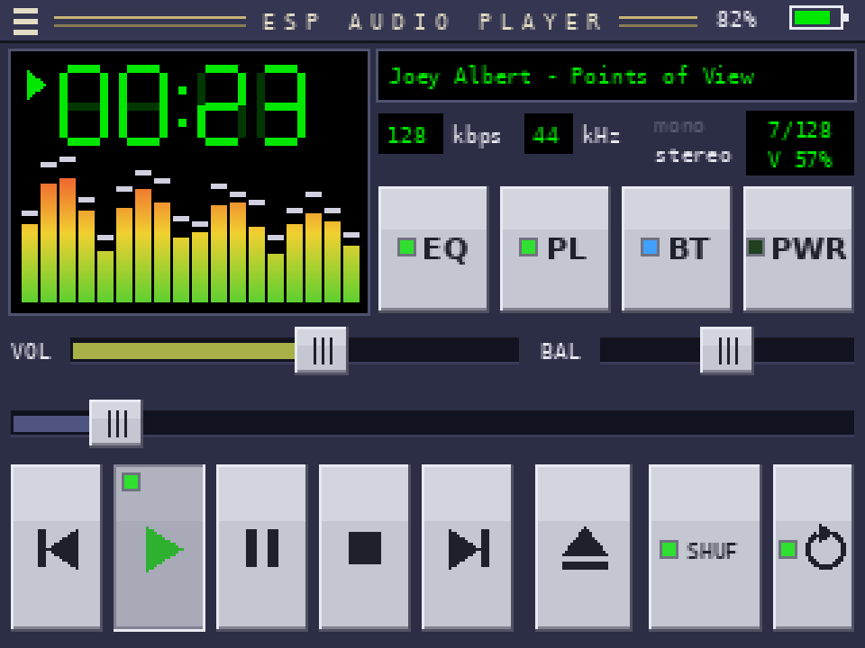
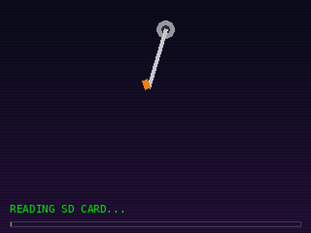
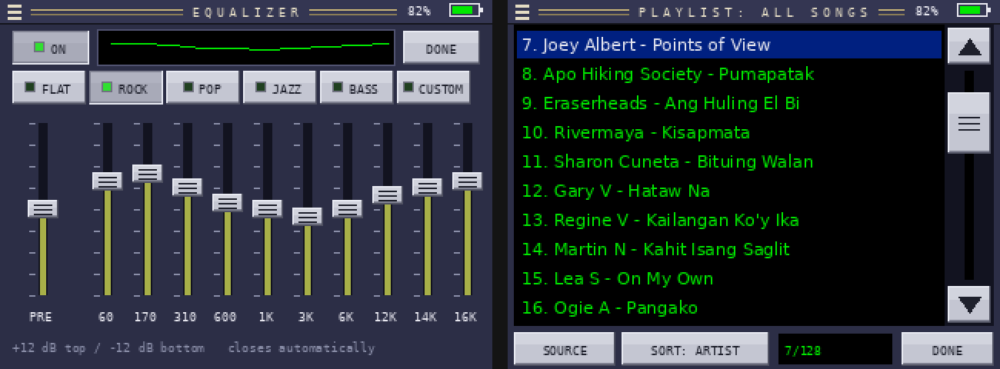
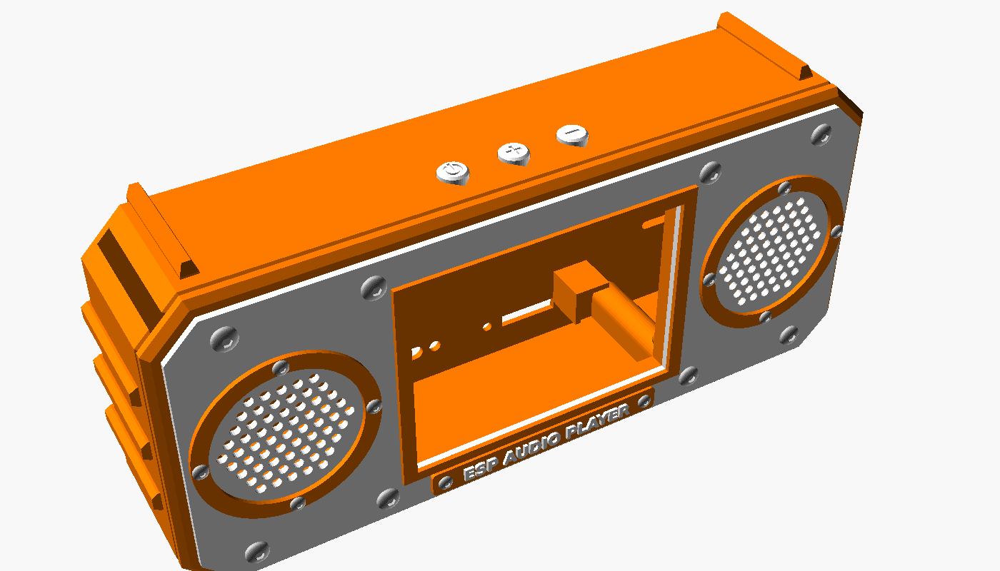

# ESP Audio Player

A retro, Winamp-inspired MP3 / FLAC / WAV player and internet radio built on the **Freenove FNK0104B** (ESP32-S3, 2.8" touch display), with a 3D-printable rugged "steel" enclosure.

## Features
- RetroPlay-style touch UI: 7-segment time display, spectrum analyzer, scrolling title, silver buttons with indicator lights
- Plays MP3 / FLAC / WAV from microSD (folders, playlists, sort, shuffle, repeat all / one)
- Internet radio over Wi-Fi
- Equalizer with presets, volume + balance, 30-step smooth volume curve
- Remembers settings and the last song + position after power-off
- Battery indicator, low-battery shutdown, power off / wake with a button
- External buttons: POWER, VOL+, VOL-
- Optional Bluetooth transmitter output (Speaker / BT / Both)
- Animated boot screen

| Boot animation | Other screens |
|---|---|
|  |  |

## Hardware
| Part | Notes |
|---|---|
| Freenove FNK0104B (ESP32-S3R8, 16 MB flash, 2.8" ILI9341 + FT6336 touch) | ES8311 codec + SC8002B amp on board |
| 2 x 40 mm speaker (SQ-157E, 4 ohm) | mono output |
| 3.7 V 2000 mAh LiPo | |
| 3 x push buttons | POWER = IO21, VOL- = IO2, VOL+ = IO14 (other side to GND) |
| Panel-mount USB-C and microSD extension cables | |
| Optional Bluetooth transmitter (e.g. KCX_BT_EMITTER) | power switched by IO3, audio from ES8311 OUTP |

## Build the firmware
1. Arduino IDE with **esp32 by Espressif** board package (3.x).
2. Libraries: **ESP32-audioI2S** (schreibfaul1), **arduino-audio-driver** (pschatzmann), **LovyanGFX**.
3. Tools settings: Board **ESP32S3 Dev Module**, PSRAM **OPI PSRAM**, Flash **16MB**, Partition **Huge APP (3MB No OTA)**.
4. Open `firmware/WinampPlayer/WinampPlayer.ino` and upload.

Options are at the top of the sketch (`AUTOPLAY_ON_BOOT`, `LCD_ROTATION`, `VOL_MAX_DB`, button pins, Bluetooth pins, `BOOT_ANIM`).

## SD card
- Copy music in any folders (MP3 / FLAC / WAV).
- Playlists: `/playlists/*.m3u` (created from the player too).
- Wi-Fi for radio: create `/wifi.txt` with one `NAME,PASSWORD` per line. Keep this file off GitHub.

## Enclosure
OpenSCAD source and print-ready STLs in [`enclosure/`](enclosure/) — all parts print **without supports** (Bambu Lab P1S, PLA / PETG settings in the spreadsheet). Colourways: orange/white, black/orange, purple/orange.

## License
MIT — see [LICENSE](LICENSE).
